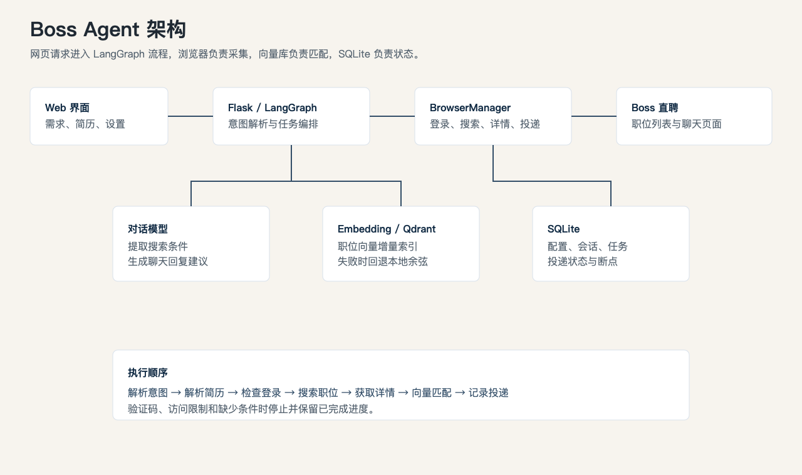
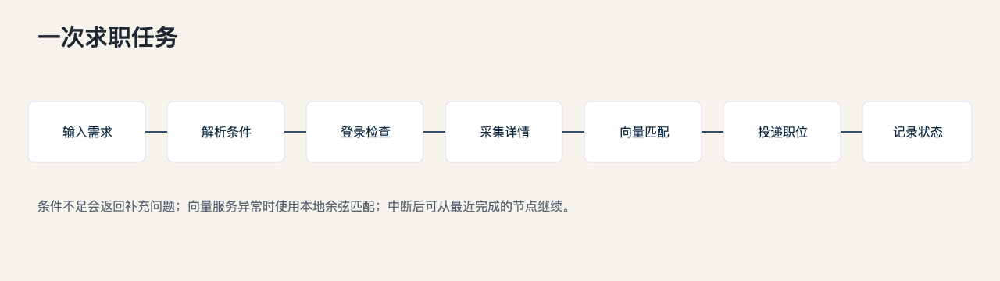

# Boss Agent

Boss Agent 是一个本地运行的求职流程助手。它通过对话理解求职需求，调用本机浏览器搜索 Boss 直聘职位，读取职位详情并进行匹配；职位搜索可以继续执行自动投递，职位推荐只返回推荐结果。



## 能做什么

- 从自然语言中提取职位、城市、薪资、经验、学历和排除条件。
- 自动区分职位搜索、职位推荐、简历分析、职位分析、闲聊和信息不明确的输入。简历分析、职位分析和闲聊不会启动浏览器；职位推荐会搜索并匹配职位，但不会自动投递。
- 通过本机浏览器检查登录、搜索职位、读取详情并执行自动投递。登录状态、解析进度、匹配进度和投递结果会实时反馈到前端。
- 用 Qdrant 保存职位向量；服务不可用时回退到本地余弦匹配。
- Qdrant 按职位文档分块建立索引，查询时按职位 ID 和城市过滤，并通过摘要、描述两个通道的 RRF 聚合计算职位相关度。
- 在 SQLite 中保存配置、会话、任务进度和投递状态，支持任务恢复、会话删除和投递幂等控制。
- 支持从对话页面暂停/继续任务；SSE 连接断开只会断开前端订阅，后台任务仍会继续运行，页面重新打开后可重新订阅；用户主动暂停或内部取消才会停止任务。
- 可选监听 Boss 聊天页面，并根据已有对话生成并发送文本自动回复；当前不发送附件，涉及薪资、面试时间和入职等场景只表达需要进一步确认，不替用户做最终承诺。



## 相比正则等传统匹配的优势

传统关键词/正则匹配靠字面命中：要为每种说法预先穷举模式，结果非黑即白，措辞一变就漏。本项目把两类条件分工处理：

- **语义相似度筛选**：先由意图解析提取目标岗位、技术能力和核心职责，再生成独立的正向 `retrieval_query`；职位文档与该查询分别编码为向量，用余弦相似度打分（`state.py`、`analysis_work_content.py`、`vector_store.py`）。地点、薪资、经验、学历和公司规模不混入向量查询，排除项也不作为正向语义条件。
- **连续打分与排序**：普通匹配入口和评估脚本可按 `threshold` 过滤并排序；生产搜索不把相似度阈值当作最终放行条件，而是先全量召回候选，再逐职位做语义审核。两条路径都不做 Top-K 截断。正则只能给出「命中/未命中」，无法区分「多像」。
- **职位方向审核**：生产流程在向量召回后，由结构化 LLM 判断职位主方向、核心职责和简历匹配情况；只有方向匹配或合理相邻、职责匹配且原文证据通过后端校验的候选才会放行。
- **自然语言意图解析**：一句「找杭州 15k 以上的 Java 后端，不要外包」由大模型解析为结构化条件和语义检索字段（`body.py`、`state.py`），无需为每种表达手写并长期维护正则规则。
- **平台筛选与语义匹配分工**：经验、学历、求职类型等主要由 Boss 列表筛选承担；详情阶段仍会对真实薪资、地点、BOSS 活跃度和排除关键词做硬性校验。职位方向和核心职责交给后续语义审核，避免把相邻职位仅凭关键词误杀。

一句话：Boss 列表接口负责扩大候选范围，代码负责真实薪资、地点、活跃度和排除项等硬过滤，向量阶段负责高召回，逐职位语义审核决定是否放行；未完成审核或不完整任务不会自动投递。

## 运行

要求 Python 3.10 及以上。建议使用虚拟环境。

```
python3 -m venv .venv
source .venv/bin/activate
pip install -r request.txt
python main.py
```

浏览器打开 [http://127.0.0.1:5001](http://127.0.0.1:5001/)。

上传简历支持 `.pdf`、`.docx` 和 `.doc`，单个文件最大 30MB。解析 `.pdf` 和 `.docx` 使用 Python 依赖；解析旧版 `.doc` 还需要本机安装 LibreOffice。若不方便安装 LibreOffice，可以先将文件另存为 `.docx`。

首次使用时，在页面设置中分别填写对话模型和 Embedding 模型的 API Key、Base URL、模型名称。Embedding 模型需要返回向量，例如 `text-embedding-3-small`。缺少必要模型配置时，前端会显示任务错误，不会静默执行。

首次搜索时，程序会打开或连接已有的 Boss 直聘浏览器实例。若尚未登录或出现验证码，需要在该浏览器窗口中手动完成；前端会显示等待登录状态，登录完成后任务自动继续。

## 任务行为

- **职位搜索**：解析筛选条件和语义检索字段，使用 Boss 的列表筛选，读取并硬过滤职位详情，再使用 `retrieval_query` 做全量向量召回；候选还要逐职位通过结构化 LLM 语义审核，只有后端校验后的 `decision=pass` 才进入后续投递。`0.45` 主要用于普通匹配入口和评估脚本，不是生产投递授权阈值，也不使用 Top-K 截断。
- **搜索计划**：城市、求职类型和薪资待遇在 BOSS 请求中按单值传递。用户选择多个值时，系统展开为“城市 × 求职类型 × 薪资”的独立搜索子任务；每个子任务持续读取到 BOSS 返回 `hasMore=false`，或检测到分页没有新增职位，组合之间相互隔离，某个组合失败后继续后续组合，并按职位 ID 去重。评估脚本仍可显式传入页数上限控制采样范围。
- 活跃度按用户意图解析为 `any`、`online` 或 `recent`：未提及时不筛选；“当前在线”使用职位列表的 `bossOnline=true` 做第一层快速筛选；“最近活跃”会追问具体天数，随后读取职位详情接口返回的 `bossActiveTime` 判断最近 N 天，接口失败时才回退详情页 DOM。活跃字段缺失或格式未知时不放行，不把“最近活跃”擅自等同于“当前在线”。
- **职位推荐**：可以根据用户条件或已上传简历提取职位方向，搜索并返回匹配结果，不执行投递。
- **简历分析**：支持 PDF、DOCX、DOC 简历解析，输出经历概括、优势、风险和修改建议；未上传简历时会先提示上传。
- **职位分析**：根据用户提供的职位描述生成分析，不启动 Boss 浏览器。
- **闲聊或需求不明确**：直接回复或要求补充信息，不进入登录检查。

职位列表、职位详情、详情页 DOM、语义模型和投递请求分别设置单次请求超时。
单个请求超时只跳过当前请求或职位，不会因为前面组合耗时较长而停止后续搜索组合。
已完成的语义结果会保留在任务快照中；任务取消、登录失效、验证码和平台访问限制
仍会停止后续浏览器操作。

前端通过 SSE 接收任务状态。任务处于登录等待、暂停或处理中时会持续发送状态和心跳；SSE 网络连接断开后，后台任务默认继续运行，页面重新打开后可通过 `active-task/stream` 重新订阅。暂停不会强行中断当前浏览器操作，任务会在安全检查点暂停；内部取消或用户主动取消才会停止任务。

## 配置

页面设置会写入 `data/config.db`。也可以用环境变量提供初始值：

```
export chat_openai_api_key="your-chat-key"
export chat_openai_base_url="https://api.openai.com/v1"
export chat_openai_model="gpt-4o-mini"
export embedding_openai_api_key="your-embedding-key"
export embedding_openai_base_url="https://api.openai.com/v1"
export embedding_openai_model="text-embedding-3-small"
export auto_reply="false"
export qdrant_enabled="true"
export semantic_concurrency="6"
export match_batch_size="6"
export semantic_cache_enabled="true"
# 可选高级配置：
# export semantic_cache_path="data/semantic_cache.db"
# export delivery_batch_size="6"
# export delivery_delay_min_seconds="4"
# export delivery_delay_max_seconds="8"
# export boss_chat_resume_path="/path/to/resume.pdf"
```

页面设置支持以下配置：

- 对话模型：`chat_openai_api_key`、`chat_openai_base_url`、`chat_openai_model`。
- Embedding 模型：`embedding_openai_api_key`、`embedding_openai_base_url`、`embedding_openai_model`。
- Qdrant：`qdrant_enabled`、`qdrant_url`、`qdrant_api_key`、`qdrant_path`、`qdrant_collection`。
- 性能：`semantic_concurrency` 默认 `6`；`match_batch_size` 未设置时跟随语义并发；`semantic_cache_enabled` 默认启用。
- 自动回复：`auto_reply`。

这些配置当前没有全部显示在设置表单中：`semantic_cache_path` 可通过环境变量或
`POST /api/config` 配置；`delivery_batch_size`、`delivery_delay_min_seconds`、
`delivery_delay_max_seconds` 和 `boss_chat_resume_path` 使用环境变量配置。语义缓存默认
写入 `data/semantic_cache.db`；自动回复未指定 `boss_chat_resume_path` 时，会选择
`data/resumes/` 中最近上传的支持格式简历。

Qdrant 默认启用，未填写 `qdrant_url` 时使用本地持久化目录 `data/qdrant/`；填写远程地址后改为连接远程 Qdrant，受保护实例再填写 `qdrant_api_key`。设置 `qdrant_enabled=false` 可关闭 Qdrant，系统会回退到本地向量匹配。

Qdrant collection 名称包含当前向量 schema 版本和 Embedding 模型标识。职位索引由两类 chunk 组成：职位名称、公司、行业、地点、薪资、经验、学历、公司规模和结构化福利组成一个不可切分的摘要块；只有职位描述按约 1200 个字符分块，并保留约 150 个字符重叠。职位内容或索引配置变化时会删除旧 chunks 后重新建立索引；旧 collection 不会自动迁移。福利会合并 BOSS 列表 card、详情页顶部标签和兼容字段并去重；详情正文中的“岗位福利”仍保留在职位描述中。城市字段缺失时按未知城市处理，不把数字城市编码当作城市名称。

当前 RAG 相关能力主要是“文档处理 + Embedding + 向量检索 + 元数据过滤 + 结果聚合”。这里的向量检索只用于在本次搜索职位中做高召回，不做全库 Top-K 召回；生产流程随后对候选逐职位进行结构化语义审核，并要求职位原文证据，只有 `decision=pass` 才放行。推荐结果仍由后端格式化输出，尚未把召回 chunk 作为带来源证据的上下文交给生成模型，因此不能把它描述成完整的生成式 RAG 闭环。

意图解析会同时输出 `retrieval_keywords` 和 `retrieval_responsibilities`，由后端生成正向 `retrieval_query`。例如“杭州 AI 应用后端开发，熟悉 Python、FastAPI、RAG、Agent，不要销售”会生成目标岗位、技术能力和后端职责；杭州由列表搜索处理，销售由排除规则处理，不会把二者混入正向 Embedding 查询。已上传简历默认先由对话模型压缩为候选人匹配画像，再将画像追加到普通搜索和职位推荐的查询中；只有用户明确要求不参考简历时才跳过。摘要失败时使用去除联系方式且有长度上限的降级文本，不把整份简历直接送入 Embedding。

当前匹配阈值为 `0.45`。这是基于 2026 年 10 月 4 日通过本地登录态采集的 40 条杭州职位评估记录得到的保守初始值，其中包含部分重复职位：前 32 条窄搜索记录中，`0.3` 保留 `32/32` 条，`0.45` 保留 `28/32` 条；另外 8 条宽搜索记录用于观察 AI 关键词误召回。该值仍需人工标注继续校准，不能视为最终精度保证。

重新评估时可运行：

```bash
PYTHONPATH=. python evaluate_matching.py \
  --case ai_backend --case python_backend --case ai_agent \
  --city 杭州 --max-pages 1 --max-jobs 8 \
  --output jobs_data/matching_evaluation_structured.json
```

评估脚本会复用项目的 DrissionPage 用户数据和当前浏览器登录态，只读取职位列表与详情，不调用投递接口。`search_query` 只负责扩大 Boss 候选集，`retrieval_query` 模拟生产匹配查询；输出中的 `human_label` 需要人工填写为 `relevant`、`irrelevant` 或 `uncertain`，不能把脚本的 `suspected_noise` 当作人工真值。2026 年 10 月 5 日的小样本共评分 18 条职位，`0.45` 下全部通过，其中 4 条被启发式标记为销售、运营或合伙人类疑似噪声；这说明当前阈值还不能仅凭这批数据调整。

`auto_reply=false` 时不会启动聊天监听线程。`auto_reply=true` 会启动独立的 Boss 聊天监听线程；浏览器尚未就绪时监听器会等待，连接中断后会自动重连，关闭配置后会停止监听。监听器在独立的后台聊天标签页中订阅页面的 RxJS `ChatWebsocket.message$`，启动时会排除离线历史，避免旧消息触发自动回复。收到的新消息会保存到 `data/conversations.db` 的 `boss_chat` 会话类型；开启自动回复后，系统会调用模型生成文本并通过聊天页发送，当前不发送附件。可通过 `GET /api/chat-worker` 查看 `running`、`listening`、`received_count`、`replied_count` 和 `last_error`。

默认单次请求保护为：列表导航 10 秒、列表响应 8 秒、详情接口 8 秒、详情
DOM 30 秒、语义模型 90 秒、投递请求 15 秒。语义模型请求最多自动重试 1 次。
这些值只限制单次请求，不限制整条多地点、多类型、多薪资搜索任务的总运行时间。

投递结果未知时会记录为 `unknown`，生产流程默认不立即重发同一个结果未知的 POST；已经记录为 `sending` 或 `unknown` 的职位，超过 30 分钟租约后才允许后续任务再次尝试，避免进程中断后永久卡住。由于网络异常时远端可能已经收到请求，租约恢复仍不能完全排除远端重复投递的可能性。

## 筛选映射

自然语言筛选项先由对话模型映射到标准选项名称，后端再从 `data/` 下的 JSON 码表读取 Boss 参数：

- `data/money_codes.json`：薪资。
- `data/job_type_codes.json`：求职类型。
- `data/experience_codes.json`：经验。
- `data/degree_codes.json`：学历。
- `data/scale_codes.json`：公司规模。
- `data/city_codes.json`：城市。

后端对码表名称执行精确匹配，不会自行猜测或生成编码；这一步只保证发送给 Boss 的搜索参数合法，不是详情职位的二次资格校验。排除关键词是职位内容过滤条件，会对职位名称、职位描述和行业字段进行不区分大小写的包含匹配；它不是对整条用户输入做正则匹配。

## 项目结构

- `main.py`：启动 Web 服务和可选聊天监听。
- `web_flask.py`：页面、配置、会话和任务接口。
- `body.py`：意图解析、简历解析和 LangGraph 流程。
- `tools.py`：`read_resume` 和 `collect_job_candidates` 两个可复用 Tool 的输入输出边界。
- `browser.py`：Boss 页面操作。
- `job.py`：详情采集、匹配和投递管线。
- `matcher.py`：码表读取、排除关键词过滤和匹配入口。
- `vector_store.py`：Qdrant 索引与召回。
- `conversation_store.py`、`delivery_store.py`：网页会话、BOSS 聊天、任务和投递状态存储。
- `boss_chat_auto_reply.py`：BOSS 求职沟通自动回复 MVP，负责场景判断、候选人资料注入和模型回复。
- `chat_worker.py`：独立聊天监听线程，保存新消息并在开启配置时发送文本自动回复。
- `sql.py`：SQLite 连接、事务、线程锁和关闭逻辑的公共封装。
- `semantic_cache.py`：语义审核结果的 SQLite 缓存。
- `data/*_codes.json`：职位筛选与城市映射码表。

## 接口

页面由 Flask 应用提供，主要接口包括：

- `GET /api/health`：服务健康状态。
- `GET /api/config`、`POST /api/config`：读取和保存页面配置。
- `GET /api/conversations`、`POST /api/conversations`：查询和创建会话。
- `GET /api/conversations/<conversation_id>/messages`：读取会话消息。
- `DELETE /api/conversations/<conversation_id>`：删除会话及关联消息、任务快照和上传简历。
- `POST /api/chat`：提交聊天任务并通过 SSE 返回状态和结果。
- `GET /api/tasks`、`GET /api/tasks/<task_id>`：查询可恢复任务或任务快照。
- `GET /api/tasks/<task_id>/results`：读取任务完整结果快照。
- `GET /api/conversations/<conversation_id>/active-task`：查询会话当前关联的运行中任务。
- `GET /api/tasks/<task_id>/stream`：重新订阅运行中任务的 SSE 事件。
- `POST /api/tasks/<task_id>/pause`、`POST /api/tasks/<task_id>/resume`：暂停或继续任务。
- `GET /api/chat-worker`：查看聊天监听线程和自动回复状态。

## 数据与限制

`.env`、SQLite 数据库、上传简历、浏览器用户目录、Qdrant 数据、运行日志和测试/调试数据都保留在本机，不提交到 Git。

网页求职会话和 BOSS 聊天监听使用同一 SQLite 文件的不同会话类型：
`web` 只显示在左侧网页会话列表中，`boss_chat` 只供聊天监听和自动回复使用。
升级旧数据库时，系统会根据历史消息来源自动标记已有 BOSS 聊天记录，不会删除聊天内容。

默认本地数据位置：

- `data/config.db`：页面配置。
- `data/conversations.db`：会话、消息和任务快照。
- `data/deliveries.db`：职位投递状态和尝试次数。
- `data/semantic_cache.db`：语义审核缓存，路径可由 `semantic_cache_path` 覆盖。
- `data/resumes/`：上传的简历。
- `data/qdrant/`：本地 Qdrant 数据。
- `logs/`：运行日志。

程序依赖 Boss 页面结构和本机登录状态。页面改版、验证码、访问限制或账号风控都可能使采集中断；任务会保留已完成的进度，但不会绕过网站限制。
